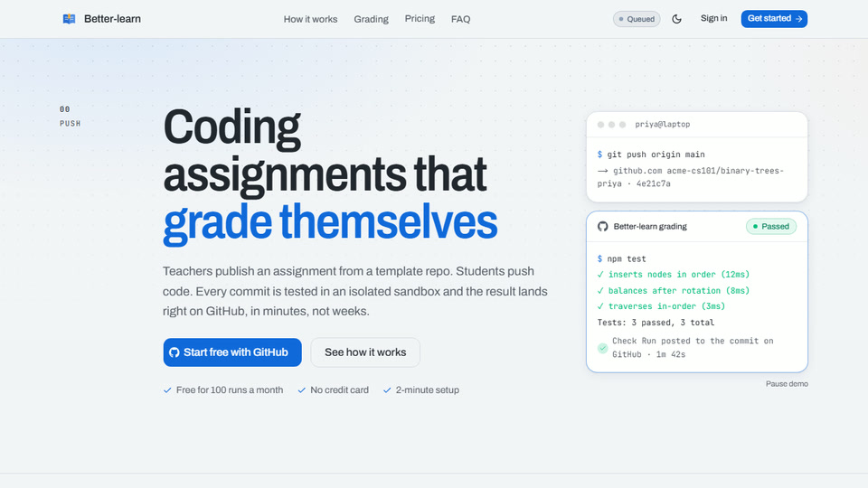
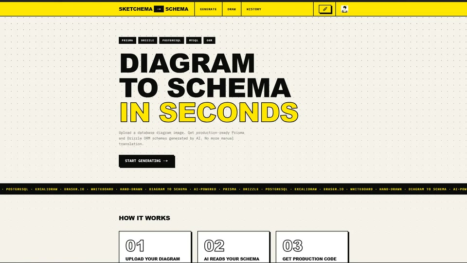
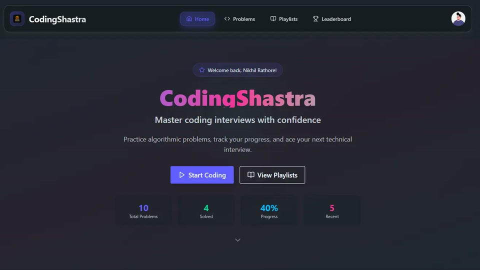
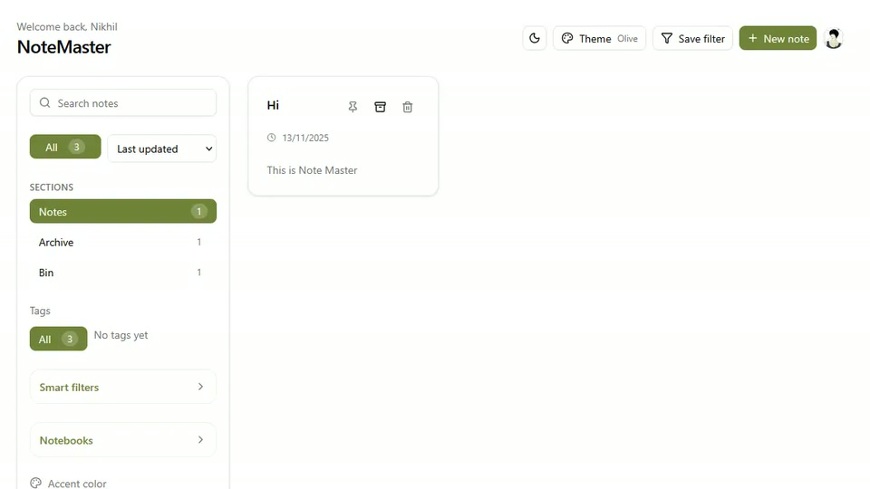

<div align="center">

<picture>
  <source media="(prefers-color-scheme: dark)" srcset="https://capsule-render.vercel.app/api?type=waving&color=0:1a1b27%2C60:3d59a1%2C100:7aa2f7&height=210&section=header&text=Nikhil%20Rathore&fontSize=54&fontAlignY=36&desc=Full%20Stack%20Developer%20%C2%B7%20New%20Delhi&descSize=18&descAlignY=56&fontColor=c0caf5">
  
</picture>


<a href="https://www.nikhilrathore.com/"></a>
<a href="https://www.nikhilrathore.com/MyResume.pdf"></a>
<a href="https://x.com/blazeiscoding"></a>
<a href="https://linkedin.com/in/nikhilrathore986"></a>
<a href="https://youtube.com/@akanesp"></a>
<a href="https://instagram.com/blaz_nikhil"></a>
<a href="mailto:nikhilrathore52297@gmail.com"></a>

</div>

## About me

```ts
const nikhil = {
  role: "Software Engineer & Forward Deployed Engineer @ Bug0",
  location: "New Delhi, India",
  building: "Tandem, open-source team chat you host yourself",
  stack: ["TypeScript", "React", "Next.js", "Node.js", "PostgreSQL"],
  learning: ["Docker", "Cloud", "DevOps"],
};
```

Right now most of my evenings go into **[Tandem](https://github.com/Blazeiscoding/Tandem)**. You run the server on a VPS, or host a workspace from your own PC the way you'd open a Minecraft world to LAN, and every message, file and account stays in one folder on your machine.

## Featured projects

<a href="https://www.better-learn.tech/">
  <picture>
    <source media="(prefers-color-scheme: dark)" srcset="assets/better-learn-fig-dark.svg">
    
  </picture>
</a>

<sub>Better-learn as a machine. Pushes wait in the queue, one at a time rides into a closed sandbox, three probes run its tests, and the score goes back to GitHub as a check.</sub>

<table>
  <tr>
    <td width="50%" valign="top">
      <a href="https://www.better-learn.tech/"></a>
      <h3><a href="https://www.better-learn.tech/">Better-learn</a></h3>
      <p>Coding assignments that grade themselves. Students push to their own private repo, every commit runs in an isolated E2B sandbox, and the result shows up as a GitHub check.</p>
      <sub>Next.js · Prisma · PostgreSQL · E2B · BullMQ</sub>
    </td>
    <td width="50%" valign="top">
      <a href="https://sketchema.vercel.app/"></a>
      <h3><a href="https://sketchema.vercel.app/">SketchSchema</a></h3>
      <p>Diagram to schema in seconds. Drop in a whiteboard photo, an Excalidraw or Eraser export, or a hand-drawn sketch, and get Prisma and Drizzle code back.</p>
      <sub>Next.js · AI · Prisma · Drizzle</sub>
    </td>
  </tr>
  <tr>
    <td width="50%" valign="top">
      <a href="https://codingshastra.nikhilrathore.com/"></a>
      <h3><a href="https://codingshastra.nikhilrathore.com/">Coding Shastra</a> <sup><a href="https://github.com/Blazeiscoding/LeetLab">code</a></sup></h3>
      <p>Interview practice platform. Solve problems in an in-browser editor, run them against test cases, build playlists and climb a monthly leaderboard.</p>
      <sub>React · Express · Prisma · PostgreSQL</sub>
    </td>
    <td width="50%" valign="top">
      <a href="https://notemaster-app.vercel.app/"></a>
      <h3><a href="https://notemaster-app.vercel.app/">Note Master</a> <sup><a href="https://github.com/Blazeiscoding/notemaster-app">code</a></sup></h3>
      <p>Mobile-first notes app with per-user encryption. Works offline as a guest and syncs once you sign in.</p>
      <sub>Next.js · TypeScript · Clerk · PostgreSQL</sub>
    </td>
  </tr>
</table>

## Tech I use

<p align="center">
  <picture>
    <source media="(prefers-color-scheme: dark)" srcset="https://skillicons.dev/icons?i=ts%2Cjs%2Creact%2Cnextjs%2Cnodejs%2Cexpress%2Cbun%2Cvite%2Ctailwind%2Cprisma%2Cpostgres%2Cmongodb%2Credis%2Cdocker%2Caws%2Cvercel%2Cgit%2Cpostman%2Ccpp%2Cc&perline=10">
    
  </picture>
</p>

## GitHub stats

<div align="center">
  <picture>
    <source media="(prefers-color-scheme: dark)" srcset="https://github-readme-stats.vercel.app/api?username=Blazeiscoding&show_icons=true&theme=tokyonight&hide_border=true">
    
  </picture>
  <picture>
    <source media="(prefers-color-scheme: dark)" srcset="https://github-readme-stats.vercel.app/api/top-langs/?username=Blazeiscoding&layout=compact&langs_count=8&theme=tokyonight&hide_border=true">
    
  </picture>
  <br>
  <picture>
    <source media="(prefers-color-scheme: dark)" srcset="https://github-readme-streak-stats.herokuapp.com/?user=Blazeiscoding&theme=tokyonight&hide_border=true">
    
  </picture>
</div>

<br>

<div align="center">

If something I built saved you some time, you can buy me a coffee.

<a href="https://paypal.me/blazeop69"></a>


<picture>
  <source media="(prefers-color-scheme: dark)" srcset="https://capsule-render.vercel.app/api?type=waving&color=0:7aa2f7%2C40:3d59a1%2C100:1a1b27&height=110&section=footer">
  
</picture>

</div>
