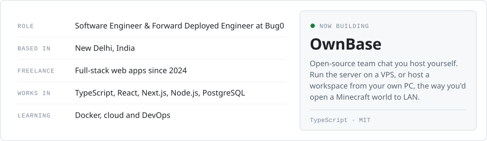
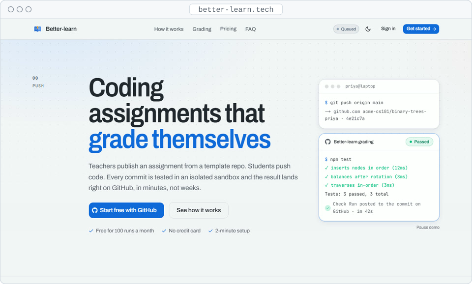
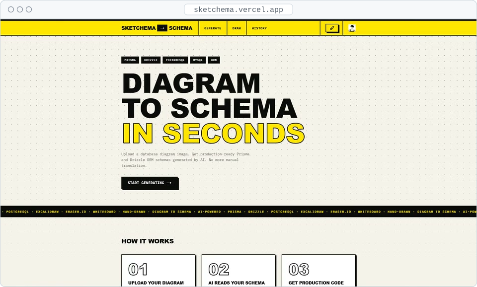
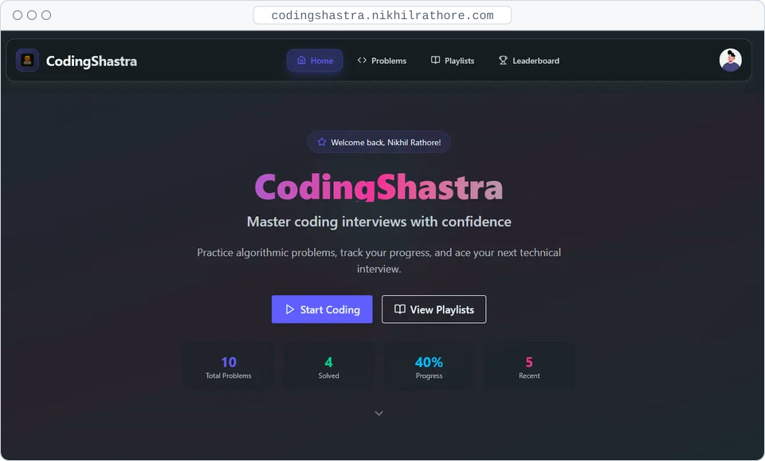
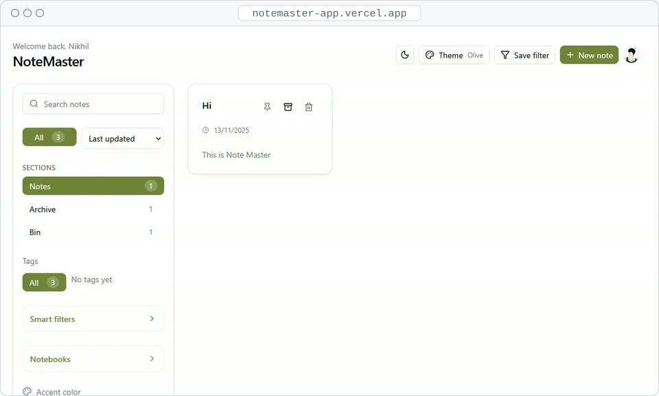
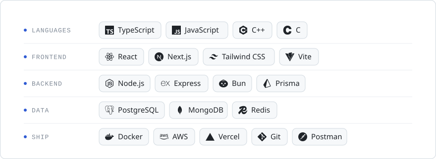

<picture>
  <source media="(prefers-color-scheme: dark)" srcset="assets/header-dark.svg">
  
</picture>

  <a href="https://www.nikhilrathore.com/">Portfolio</a> ·
  <a href="https://www.nikhilrathore.com/MyResume.pdf">Resume</a> ·
  <a href="https://x.com/blazeiscoding">X</a> ·
  <a href="https://linkedin.com/in/nikhilrathore986">LinkedIn</a> ·
  <a href="https://youtube.com/@akanesp">YouTube</a> ·
  <a href="https://instagram.com/blaz_nikhil">Instagram</a> ·
  <a href="mailto:nikhilrathore52297@gmail.com">Email</a>

## About me

<picture>
  <source media="(prefers-color-scheme: dark)" srcset="assets/about-dark.svg">
  
</picture>

Tandem lives at <a href="https://github.com/Blazeiscoding/Tandem">github.com/Blazeiscoding/Tandem</a>. Every message, file and account stays in one folder on the host's machine.

## Featured projects

<picture>
  <source media="(prefers-color-scheme: dark)" srcset="assets/better-learn-fig-dark.svg">
  
</picture>

<a href="https://www.better-learn.tech/">Better-learn</a> as a machine. Pushes wait in the queue, one at a time rides into a closed sandbox, three probes run its tests, and the score goes back to GitHub as a check.

<table>
  <tr>
    <td width="50%" valign="top">
      <picture>
        <source media="(prefers-color-scheme: dark)" srcset="assets/better-learn-frame-dark.svg">
        
      </picture>
      <h3><a href="https://www.better-learn.tech/">Better-learn</a></h3>
      
Coding assignments that grade themselves. Students push to their own private repo, every commit runs in an isolated E2B sandbox, and the result shows up as a GitHub check.

      Next.js · Prisma · PostgreSQL · E2B · BullMQ
    </td>
    <td width="50%" valign="top">
      <picture>
        <source media="(prefers-color-scheme: dark)" srcset="assets/sketchschema-frame-dark.svg">
        
      </picture>
      <h3><a href="https://sketchema.vercel.app/">SketchSchema</a></h3>
      
Diagram to schema in seconds. Drop in a whiteboard photo, an Excalidraw or Eraser export, or a hand-drawn sketch, and get Prisma and Drizzle code back.

      Next.js · AI · Prisma · Drizzle
    </td>
  </tr>
  <tr>
    <td width="50%" valign="top">
      <picture>
        <source media="(prefers-color-scheme: dark)" srcset="assets/coding-shastra-frame-dark.svg">
        
      </picture>
      <h3><a href="https://codingshastra.nikhilrathore.com/">Coding Shastra</a> <a href="https://github.com/Blazeiscoding/LeetLab">code</a></h3>
      
Interview practice platform. Solve problems in an in-browser editor, run them against test cases, build playlists and climb a monthly leaderboard.

      React · Express · Prisma · PostgreSQL
    </td>
    <td width="50%" valign="top">
      <picture>
        <source media="(prefers-color-scheme: dark)" srcset="assets/note-master-frame-dark.svg">
        
      </picture>
      <h3><a href="https://notemaster-app.vercel.app/">Note Master</a> <a href="https://github.com/Blazeiscoding/notemaster-app">code</a></h3>
      
Mobile-first notes app with per-user encryption. Works offline as a guest and syncs once you sign in.

      Next.js · TypeScript · Clerk · PostgreSQL
    </td>
  </tr>
</table>

## Tech I use

<picture>
  <source media="(prefers-color-scheme: dark)" srcset="assets/stack-dark.svg">
  
</picture>

## A year on GitHub

<picture>
  <source media="(prefers-color-scheme: dark)" srcset="https://raw.githubusercontent.com/Blazeiscoding/Blazeiscoding/readme-assets/contributions-dark.svg">
  
</picture>

<picture>
  <source media="(prefers-color-scheme: dark)" srcset="https://raw.githubusercontent.com/Blazeiscoding/Blazeiscoding/readme-assets/stats-dark.svg">
  
</picture>

Both are redrawn every day from live GitHub data by <a href=".github/workflows/readme-art.yml">a workflow in this repo</a>.

 

If something I built saved you some time, you can <a href="https://paypal.me/blazeop69">buy me a coffee</a>.

